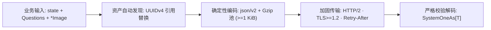
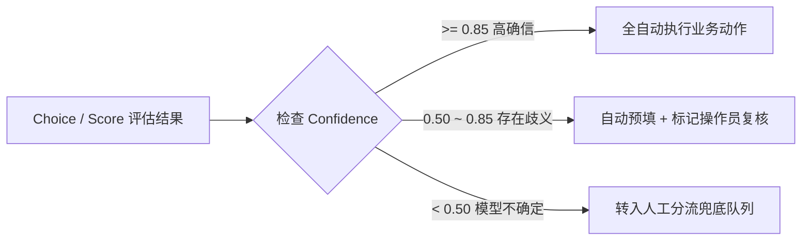

<div align="center">

# TypeSafe AI Go SDK

**告别脆弱的大模型自由文本解析 —— 单次并行调用，直接获得经概率校准的定性判断、多类分流、量表评分与视觉边界框。**

[](https://github.com/guchengod/typesafe-sdk-go/releases/latest)
[](https://go.dev/)
[](go.mod)
[](https://github.com/guchengod/typesafe-sdk-go/actions/workflows/ci.yml)
[](https://goreportcard.com/report/github.com/guchengod/typesafe-sdk-go)
[](https://pkg.go.dev/github.com/guchengod/typesafe-sdk-go)
[](LICENSE)

[**English**](README_EN.md) · **简体中文**

[为什么选择 System One](#为什么选择-system-one) · [30 秒快速上手](#30-秒快速上手) · [架构流水线](#sdk-请求流水线架构) · [四大决策原语](#四大决策原语) · [多模态与目标定位](#多模态图像与目标定位) · [生产级模式](#生产级工程模式) · [CLI 工具](#命令行工具-cli) · [AI Agent 规则](#-ai-agent-专用系统提示词)

</div>

---

[TypeSafe AI](https://typesafe.ai) 官方 Go 客户端与命令行工具，面向确定性业务流打造。底层 **Jev（System One）** 模型不生成散漫的聊天文本，而是在一次 HTTP 往返中对数十个原子问题进行**并行推理**，直接将经统计校准的概率分布解码进你的 Go 泛型结构体：

```go
type TicketVerdict struct {
	Billing  typesafe.NoulAnswer   `json:"billing"`
	Dept     typesafe.ChoiceAnswer `json:"dept"`
	Urgency  typesafe.ScoreAnswer  `json:"urgency"`
	Evidence *typesafe.BoxAnswer   `json:"evidence,omitzero"`
}

verdict, err := client.SystemOneAs[TicketVerdict](ctx, ticketState, questions)
// verdict.Billing.Noul       => 0.99   (校准后的 Yes 概率)
// verdict.Dept.Choice        => "billing" (Confidence: 1.00)
// verdict.Urgency.Score      => 1.98 / 2  (Confidence: 0.98)
```

---

## 为什么选择 System One？

在风控审核、工单路由、内容分级、多模态质检等工程链路中，我们需要的是**可度量置信度的确定性分支信号**，而不是等待通用大模型逐 Token 吐出 JSON 字符串再祈祷正则不要崩：

| 维度 | 传统 LLM Prompt + JSON 解析（System Two） | TypeSafe System One（Jev）+ Go SDK |
| :--- | :--- | :--- |
| **输出形态** | 自由文本 / 易幻觉的 JSON 字符串，需反复清洗重试 | 4 种受严格协议约束的强类型答案（`Noul` / `Choice` / `Score` / `Box`） |
| **置信度真实性** | 模型自报 `"confidence": 0.95` 缺乏统计校准，常过度自信 | 原生输出校准概率分布与统计确定性 `Confidence` $\in [0, 1]$ |
| **多问题吞吐** | 问题越多输出 Token 越长，首字与尾字延迟线性膨胀 | 单次调用并行评估数十个问题，线上典型端到端耗时 **~250ms** |
| **代码解耦** | Prompt 混杂算术、计数与格式约束，难以单测演进 | **Jev 专注定性判断，Go 专注算术与确定性控制流** |
| **SDK 运行时开销** | 常引入多层第三方序列化与日志依赖树 | **零外部依赖纯标准库**，单次调用 SDK 侧开销仅 **~13.5 µs（165 allocs）** |

### 核心工程特性（`v0.15.0`）

- **纯 Go 1.27 标准库零依赖**：[go.mod](go.mod) 仅 3 行、无 `go.sum`。原生基于 `encoding/json/v2`、标准库 `uuid`、`log/slog`、`os.Root` 与 Go 1.27 泛型方法 `(*Client).SystemOneAs[T]` 构建。
- **极致热路径性能**：内置 `gzip.Writer` `sync.Pool` 复用池（请求体 $\ge 1\text{ KiB}$ 自动透明压缩）、栈上零分配敏感标头脱敏与预规范化 MIME 键。
- **纵深安全防护**：非回环地址默认强制 HTTPS（TLS $\ge 1.2$），跨源重定向自动剥离凭据并拒绝重放请求体，支持 `NewImageFromRoot` 目录沙箱防路径穿越、PNG/JPEG 魔数校验及全嵌套日志脱敏（`RedactingHandler`）。
- **结构化并发与零泄漏门禁**：`Client` 天然并发安全，支持 `context.WithTimeoutCause` 精准区分“单次尝试超时”与“调用方取消”，`RetryPolicy.Timeout` 全链路约束在途请求，全仓通过 `-race` 与 Go 1.27 `runtime/pprof` `goroutineleak` 门禁验证。

---

## SDK 请求流水线架构



---

## 30 秒快速上手

> 环境要求：**Go 1.27.3 或更高版本**。

### 1. 安装 SDK

```bash
go get github.com/guchengod/typesafe-sdk-go@latest
```

### 2. 配置密钥并运行

```bash
export TYPESAFE_API_KEY="ts_live_..."
```

```go
package main

import (
	"context"
	"fmt"
	"log"

	typesafe "github.com/guchengod/typesafe-sdk-go"
)

type TriageResult struct {
	Model    string                `json:"model"`
	Usage    typesafe.Usage        `json:"usage"`
	Billing  typesafe.NoulAnswer   `json:"billing"`
	Category typesafe.ChoiceAnswer `json:"category"`
	Urgency  typesafe.ScoreAnswer  `json:"urgency"`
}

func main() {
	client, err := typesafe.NewClient() // 自动读取 TYPESAFE_API_KEY
	if err != nil {
		log.Fatal(err)
	}
	defer func() { _ = client.Close() }()

	result, err := client.SystemOneAs[TriageResult](
		context.Background(),
		map[string]any{
			"channel": "email",
			"body":    "信用卡账单 #4912 今天被重复扣费了两次，请立即退还多扣的款项！",
		},
		typesafe.Questions{
			"billing": typesafe.NewNoul("该消息是否涉及账单、扣费或退款？"),
			"category": typesafe.NewChoice(
				map[string]any{
					"billing":   "扣费异常、退款申请或发票问题",
					"technical": "系统报错、崩溃或 API 故障",
					"other":     nil, // nil 表示该标签无需额外解释
				},
				typesafe.WithInstructions("该工单应分流至哪个队列？"),
			),
			"urgency": typesafe.NewScore(
				[]any{"常规咨询（可下周处理）", "重要问题（48 小时内响应）", "高优紧急（需当天处理）"},
				typesafe.WithInstructions("客户诉求的紧急程度如何？"),
			),
		},
	)
	if err != nil {
		log.Fatal(err)
	}

	fmt.Printf("模型: %s | Tokens: %d in / %d out\n", result.Model, result.Usage.InputTokens, result.Usage.OutputTokens)
	fmt.Printf("账单相关 p(true) = %.2f\n", result.Billing.Noul)
	fmt.Printf("分流队列         = %s (置信度 %.2f)\n", result.Category.Choice, result.Category.Confidence)
	fmt.Printf("紧急程度评分     = %.2f / 2 (置信度 %.2f)\n", result.Urgency.Score, result.Urgency.Confidence)
}
```

如果不希望预定义结构体，也可以直接调用 `resp, err := client.SystemOne(ctx, state, questions)`，通过 `resp.Nouls()`、`resp.Choices()`、`resp.Scores()` 和 `resp.Boxes()` 动态读取分组结果（包级函数 `typesafe.SystemOneAs[T](ctx, client, ...)` 亦保持完整向后兼容）。

---

## 四大决策原语

TypeSafe 提供四种正交的定性决策原语，可在同一个 `typesafe.Questions` 中任意组合：

| 原语 | 构造函数 | 响应类型与核心字段 | 规格约束与适用场景 |
| :--- | :--- | :--- | :--- |
| **Noul**<br/>二元概率判断 | `NewNoul(instructions, opts...)` | `*NoulAnswer`<br/>`Noul` (`0.0 ~ 1.0`) | 返回命题为真的校准概率。适用于合规过滤、意图识别及扇出原子判断。可通过 `WithNoulCriteria` 补充正反例定义。 |
| **Choice**<br/>互斥多分类 | `NewChoice(criteria, opts...)` | `*ChoiceAnswer`<br/>`Choice`, `Confidence`, `Probabilities` | 最多支持 **255 个选项**。返回最高概率标签、完整概率分布及确定性得分，适用于工单路由与分类打标。 |
| **Score**<br/>有序量表评级 | `NewScore(criteria, opts...)` | `*ScoreAnswer`<br/>`Score`, `Confidence`, `Probabilities`, `Legend` | 量表须包含 **2 ~ 10 个有序等级**（对应分值 `0 .. N-1`）。`Score` 为概率加权期望分，适合阈值门禁过滤。 |
| **Box**<br/>视觉目标定位 | `NewBox(instructions, opts...)` | `*BoxAnswer`<br/>`Box` (`Top`,`Bottom`,`Left`,`Right`), `Confidence` | 需 Jev 1.14 模型（默认 `jev-latest` 即支持）。输出 `[0, 1]` 归一化边缘坐标，支持 `.Bounds(w, h)` 直接转像素裁剪框。 |

---

## 多模态图像与目标定位

`*typesafe.Image` 可直接嵌入 `state`、问题 `instructions` 或 `criteria` 的任意层级 —— SDK 会自动扫描提取资产、分配标准 UUIDv4 引用并附带 `TypeSafe-Danger-Zone-Images: true` 标头。

处理用户上传路径时，推荐使用 **`NewImageFromRoot`**（基于 Go `os.Root` 内核级目录沙箱，自动拦截 `../` 与符号链接逃逸，并校验 PNG/JPEG 文件头魔数）：

```go
uploadRoot, err := os.OpenRoot("/var/app/uploads")
if err != nil {
	log.Fatal(err)
}
defer func() { _ = uploadRoot.Close() }()

// 安全加载受信目录内的图像（单图上限 16 MiB，支持 PNG / JPEG）
photo, err := typesafe.NewImageFromRoot(uploadRoot, userProvidedFilename)
if err != nil {
	log.Fatal(err)
}

resp, err := client.SystemOne(
	ctx,
	map[string]any{"scene": photo},
	typesafe.Questions{
		"has_defect": typesafe.NewNoul("`scene` 中的电路板是否存在焊点缺陷？"),
		"defect_box": typesafe.NewBox("`scene` 中的焊点缺陷区域"),
	},
)
if err != nil {
	log.Fatal(err)
}

if resp.Nouls()["has_defect"].Noul >= 0.80 {
	box := resp.Boxes()["defect_box"]
	// Bounds 会自动将 [0,1] 归一化坐标安全夹逼并换算为像素级 image.Rectangle，杜绝越界切片 Panic
	cropRect := box.Box.Bounds(1920, 1080)
	fmt.Printf("定位到缺陷区域: %v (归一化合法=%v)\n", cropRect, box.Box.IsNormalized())
}
```

---

## 生产级工程模式

### 1. 置信度三段式分流路由（Confidence-Gated Routing）

`Choice` 与 `Score` 同时返回预测结果与统计确定性 `Confidence`。利用三段式门禁，可以在全自动处理与人工兜底之间建立清晰的安全边界：



```go
dept := verdict.Category
switch {
case dept.Confidence >= 0.85:
	dispatchAutomatically(dept.Choice)
case dept.Confidence >= 0.50:
	enqueueWithSuggestedLabel(dept.Choice, dept.Probabilities)
default:
	routeToHumanTriage()
}
```

### 2. 投机性扇出计数（Speculative Fan-Out）

> [!IMPORTANT]
> Jev 是定性判断模型而非算术计算器，也不应将 `Score` 当作连续物理量做线性插值。需要统计“有多少条目满足条件”时，请在一次 `SystemOne` 请求中扇出多个原子 `Noul` 问题，再由 Go 代码精确汇总。

```go
questions := make(typesafe.Questions, len(logs))
for i, entry := range logs {
	questions[fmt.Sprintf("item_%d", i)] = typesafe.NewNoul(
		map[string]any{"entry": entry, "ask": "该日志是否表明发生了权限越界或活跃攻击？"},
	)
}

resp, err := client.SystemOne(ctx, "security-audit-batch", questions)
if err != nil {
	return err
}

criticalCount := 0
for _, ans := range resp.Nouls() {
	if ans.Noul >= 0.80 {
		criticalCount++
	}
}
```

### 3. 双层超时预算、自适应重试与递归脱敏日志

SDK 支持同时控制**单次 HTTP 尝试超时**（`WithTimeout`）与**包含重试及退避在内的整次调用总预算**（`RetryPolicy.Timeout`），并提供 Go 1.26+ `errors.AsType[T]` 强类型错误断言：

```go
logger := slog.New(typesafe.NewRedactingHandler(
	slog.NewJSONHandler(os.Stderr, &slog.HandlerOptions{Level: slog.LevelInfo}),
))

policy := typesafe.DefaultRetryPolicy()
policy.MaxRetries = 3
policy.Timeout = new(15 * time.Second) // 整次调用（首次 + 重试 + Retry-After 退避）硬上限

client, err := typesafe.NewClient(
	typesafe.WithTimeout(5 * time.Second), // 单次 HTTP 尝试上限
	typesafe.WithRetryPolicy(policy),
	typesafe.WithLogger(logger),
)
if err != nil {
	log.Fatal(err)
}

resp, err := client.SystemOne(ctx, state, questions)
if err != nil {
	if rlErr, ok := errors.AsType[*typesafe.RateLimitError](err); ok {
		wait, _ := rlErr.RetryAfter()
		log.Printf("触发限流 (req_id=%s)，建议等待 %v", rlErr.RequestID, wait)
	} else if toErr, ok := typesafe.AsTimeoutError(err); ok {
		log.Printf("请求超时 (timeout=%v): %v", toErr.Timeout, toErr)
	} else if apiErr, ok := typesafe.AsAPIError(err); ok {
		log.Printf("API 错误 status=%d req_id=%s: %s", apiErr.Status, apiErr.RequestID, apiErr.Message)
	}
}
```

---

## 命令行工具 (CLI)

仓库内置纯标准库打造的命令行工具 `typesafe`，所有发行版二进制均附带 GitHub Actions **SLSA 构建溯源证明**。

### 安装方式

**方式一：通过 `go install` 从源码安装**

```bash
go install github.com/guchengod/typesafe-sdk-go/cmd/typesafe@latest
```

**方式二：下载预编译二进制（[GitHub Releases](https://github.com/guchengod/typesafe-sdk-go/releases/latest)）**

| 操作系统 | 架构 | 下载资产 |
| :--- | :--- | :--- |
| **macOS** | Apple Silicon (`arm64`) / Intel (`amd64`) | [`typesafe_*_darwin_arm64`](https://github.com/guchengod/typesafe-sdk-go/releases/latest) · [`typesafe_*_darwin_amd64`](https://github.com/guchengod/typesafe-sdk-go/releases/latest) |
| **Linux** | `amd64` / `arm64` | [`typesafe_*_linux_amd64`](https://github.com/guchengod/typesafe-sdk-go/releases/latest) · [`typesafe_*_linux_arm64`](https://github.com/guchengod/typesafe-sdk-go/releases/latest) |
| **Windows** | `amd64` / `arm64` | [`typesafe_*_windows_amd64.exe`](https://github.com/guchengod/typesafe-sdk-go/releases/latest) · [`typesafe_*_windows_arm64.exe`](https://github.com/guchengod/typesafe-sdk-go/releases/latest) |

```bash
# 可选：使用 GitHub CLI 验证二进制 SLSA 构建溯源签名
gh attestation verify typesafe_0.15.0_darwin_arm64 --repo guchengod/typesafe-sdk-go
```

### 终端与 CI 流水线实战

```bash
# 1. 查看账号可用模型表格
typesafe models --format text

# 2. 使用文件密钥与多原语参数直接评估（避免命令行历史泄露 API Key）
typesafe ask \
  --api-key-file ~/.config/typesafe/key \
  --state '{"body": "账单 #4912 被扣了两次款。"}' \
  --noul 'billing=这是账单问题吗？' \
  --choice 'queue=billing:财务账单,technical:技术故障,other' \
  --score 'urgency=日常,紧急,严重' \
  --format text

# 3. Unix 管道流式读取 stdin + jq 提取结构化 JSON（支持 Ctrl-C 即时中断退出）
cat ticket.json | typesafe ask --state - --questions-file questions.json | jq '.answers'
```

CLI 退出码严格区分错误类别：
- `0`：调用成功
- `1`：命令行参数或本地输入校验错误（未发起网络请求）
- `2`：服务端返回非 2xx 业务/鉴权错误（`APIError`）
- `3`：网络连接失败、超时或收到 `SIGINT`/`SIGTERM` 取消

---

## 配置环境变量参考

显式传入的 `typesafe.With*` 选项优先级始终高于环境变量：

| 环境变量 | 说明 | 默认值 |
| :--- | :--- | :--- |
| `TYPESAFE_API_KEY` | Bearer 鉴权密钥（未传 `WithAPIKey` 时必填） | — |
| `TYPESAFE_BASE_URL` | API 根地址（非回环地址默认要求 `https://`） | `https://api.typesafe.ai` |
| `TYPESAFE_DEFAULT_MODEL` | 未指定 `WithModel` 时的默认模型别名 | `jev-latest` |
| `TYPESAFE_LOG_LEVEL` | 默认 `slog` 日志级别（`debug` / `info` / `warn` / `error` / `off`） | `off`（零日志开销） |

---

## 🤖 AI Agent 专用系统提示词

正在使用 **Cursor**、**Claude Code**、**GitHub Copilot**、**Windsurf** 或 **Antigravity**？展开下方卡片并将提示词复制到项目的 `.cursorrules`、`CLAUDE.md` 或 `AGENTS.md` 中，即可让 Coding Agent 零幻觉地编写符合最新 `v0.15.0` 规范的代码：

<details>
<summary><b>📋 点击展开：一键复制 AI Coding Agent 专用规则（适配 Go 1.27 / v0.15.0）</b></summary>

````markdown
### TypeSafe AI Go SDK (`github.com/guchengod/typesafe-sdk-go`) Agent Guidelines

TypeSafe uses calibrated System One models (Jev) for deterministic classification, rubric scoring, verification, and bounding-box localization. It does NOT generate unstructured free text.

1. **Core Rules**
   - Keep arithmetic, counting, string parsing, and control flow strictly in Go. Use Jev strictly for qualitative judgments.
   - Construct one `*typesafe.Client`, share it across goroutines, pass a non-nil `context.Context` to every call, and call `defer client.Close()` once all in-flight calls complete.

2. **Client Initialization**
   ```go
   client, err := typesafe.NewClient(
       // Reads TYPESAFE_API_KEY automatically; optional overrides:
       // typesafe.WithTimeout(10 * time.Second),
       // typesafe.WithRetryPolicy(policy),
   )
   ```

3. **Four Question Primitives (`typesafe.Questions`)**
   - **Noul (Yes/No probability 0..1)**: `typesafe.NewNoul("Is this spam?")` -> `NoulAnswer.Noul`
   - **Choice (<= 255 options)**: `typesafe.NewChoice(map[string]any{"billing": "Invoices", "other": nil}, typesafe.WithInstructions("Which queue?"))` -> `ChoiceAnswer.Choice`, `.Confidence`
   - **Score (2..10 ordered rubric levels)**: `typesafe.NewScore([]any{"low", "medium", "high"}, typesafe.WithInstructions("Urgency?"))` -> `ScoreAnswer.Score`, `.Confidence`
   - **Box (normalized [0,1] object edges)**: `typesafe.NewBox("the defect in `photo`")` -> `BoxAnswer.Box.Bounds(width, height)`

4. **Strongly-Typed Generic Decoding (Preferred in Go 1.27+)**
   ```go
   type Verdict struct {
       Billing  typesafe.NoulAnswer   `json:"billing"`
       Category typesafe.ChoiceAnswer `json:"category"`
       Urgency  typesafe.ScoreAnswer  `json:"urgency"`
       Target   *typesafe.BoxAnswer   `json:"target,omitzero"`
   }
   verdict, err := client.SystemOneAs[Verdict](ctx, state, questions)
   ```

5. **Multimodal Images**
   Use `typesafe.NewImageFromFile(path)` for trusted paths or `typesafe.NewImageFromRoot(root, name)` (`*os.Root`) for untrusted user filenames (PNG/JPEG, <= 16 MiB). Embed `*typesafe.Image` directly inside `state`, `instructions`, or `criteria` — assets and `TypeSafe-Danger-Zone-Images: true` are handled automatically.

6. **Confidence-Gated Routing & Error Handling**
   - Gate `Choice`/`Score` on `Confidence`: `>= 0.85` automate, `0.50..0.85` human review, `< 0.50` fallback.
   - Inspect typed errors with `errors.AsType[*typesafe.RateLimitError](err)` or helpers `typesafe.AsAPIError(err)`, `typesafe.AsTimeoutError(err)`.
````

</details>

---

## 文档、示例与参与贡献

- [**Go Reference API 文档 (`pkg.go.dev`)**](https://pkg.go.dev/github.com/guchengod/typesafe-sdk-go) — 完整导出类型、配置项与错误体系参考
- [**Wiki 进阶指南**](https://github.com/guchengod/typesafe-sdk-go/wiki) — 重试预算、并发模型与日志脱敏详解
- [`examples/quickstart`](examples/quickstart/main.go) — 基础三原语评估示例
- [`examples/advanced`](examples/advanced/main.go) — 泛型 `client.SystemOneAs`、置信度门禁路由与扇出计数完整示例

本地开发与验证命令：

```bash
go build ./...
go test -race -shuffle=on ./...                             # 运行竞态检测单元测试与 goroutineleak 门禁
TYPESAFE_RUN_INTEGRATION=1 go test -race -run TestIntegration ./... # 运行真实 API 集成测试
go test -bench=. -benchmem -run=^$ ./...                    # 运行热路径性能与内存分配基准测试
golangci-lint run ./...                                     # 运行静态检查（含 modernize / gosec）
```

---

## 许可证

本项目基于 [MIT 许可证](LICENSE) 开源。
