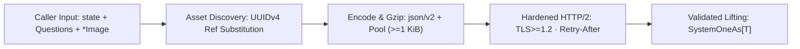
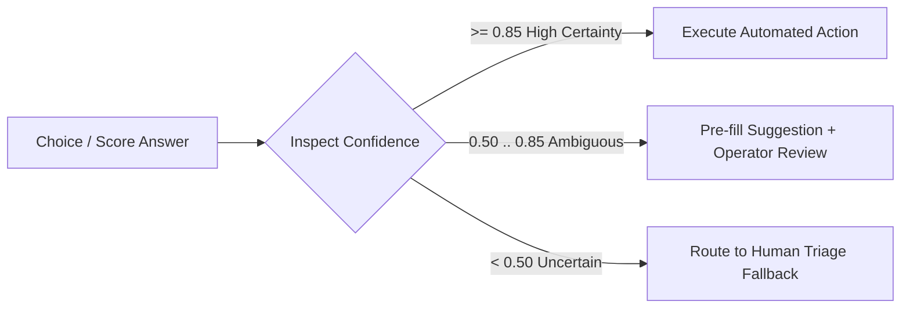

<div align="center">

# TypeSafe AI Go SDK

**Stop regex-parsing LLM prose. Get calibrated probabilities, categorical choices, rubric scores, and bounding boxes in a single parallel Go call.**

[](https://github.com/guchengod/typesafe-sdk-go/releases/latest)
[](https://go.dev/)
[](go.mod)
[](https://github.com/guchengod/typesafe-sdk-go/actions/workflows/ci.yml)
[](https://goreportcard.com/report/github.com/guchengod/typesafe-sdk-go)
[](https://pkg.go.dev/github.com/guchengod/typesafe-sdk-go)
[](LICENSE)

**English** · [**简体中文**](README.md)

[Why System One](#why-system-one) · [30-Second Quickstart](#30-second-quickstart) · [Pipeline Architecture](#request-pipeline-architecture) · [Decision Primitives](#the-four-decision-primitives) · [Multimodal & Vision](#multimodal-images--object-localization) · [Production Patterns](#production-patterns) · [CLI](#command-line-interface-cli) · [AI Agent Rules](#-ai-coding-agent-system-prompt)

</div>

---

Official Go client library and CLI for [TypeSafe AI](https://typesafe.ai). Instead of streaming unconstrained chat tokens, TypeSafe's **Jev (System One)** model evaluates dozens of atomic qualitative questions **in parallel within a single HTTP round-trip** and decodes calibrated probability distributions straight into your Go structs:

```go
type TicketVerdict struct {
	Billing  typesafe.NoulAnswer   `json:"billing"`
	Dept     typesafe.ChoiceAnswer `json:"dept"`
	Urgency  typesafe.ScoreAnswer  `json:"urgency"`
	Evidence *typesafe.BoxAnswer   `json:"evidence,omitzero"`
}

verdict, err := client.SystemOneAs[TicketVerdict](ctx, ticketState, questions)
// verdict.Billing.Noul       => 0.99   (calibrated Yes probability)
// verdict.Dept.Choice        => "billing" (Confidence: 1.00)
// verdict.Urgency.Score      => 1.98 / 2  (Confidence: 0.98)
```

---

## Why System One?

For triage, moderation, compliance gates, routing, and visual inspection, production software needs **calibrated, branchable signals**—not free-form prose wrapped in fragile JSON prompts:

| Dimension | Prompted Chat LLMs (System Two) | TypeSafe System One (Jev) + Go SDK |
| :--- | :--- | :--- |
| **Output Contract** | Unconstrained text / hallucinated JSON keys requiring repair loops | 4 schema-locked primitives (`Noul`, `Choice`, `Score`, `Box`) |
| **Calibration** | Self-reported `"confidence": 0.95` is uncalibrated and overconfident | True probability distributions + calibrated `Confidence` $\in [0, 1]$ |
| **Multi-Question Latency** | Latency grows linearly with output token count | Evaluates dozens of questions in parallel in **~250ms** end-to-end |
| **Separation of Concerns** | Prompts tangle qualitative judgment with arithmetic and formatting | **Jev handles qualitative judgment; Go handles arithmetic & control flow** |
| **Runtime Footprint** | Transitive dependency trees for JSON, UUIDs, and logging | **Zero external dependencies**; **~13.5 µs / 165 allocs** SDK overhead per call |

### Engineering Highlights (`v0.15.0`)

- **Pure Go 1.27 Standard Library (Zero Dependencies)**: A 3-line [go.mod](go.mod) with no `go.sum`. Built directly on `encoding/json/v2`, stdlib `uuid`, `log/slog`, `os.Root`, and Go 1.27 generic methods (`(*Client).SystemOneAs[T]`).
- **Low-Allocation Hot Path**: Pooled `gzip.Writer` instances via `sync.Pool` (automatic gzip for bodies $\ge 1\text{ KiB}$), stack-allocated header redaction, and pre-canonicalized MIME header keys.
- **Defense-in-Depth Security**: HTTPS-by-default on non-loopback hosts (TLS $\ge 1.2$), credential stripping and body-replay blocking across cross-origin redirects, `NewImageFromRoot` (`os.Root`) path-traversal confinement, PNG/JPEG magic-byte verification, and recursive secret scrubbing (`RedactingHandler`).
- **Structured Concurrency & Leak Gates**: Lock-free concurrent `Client` sharing, `context.WithTimeoutCause` disambiguation between per-attempt timeouts and caller cancellation, `RetryPolicy.Timeout` enforcement across in-flight attempts, verified under `-race` and Go 1.27 `runtime/pprof` `goroutineleak` gates.

---

## Request Pipeline Architecture



---

## 30-Second Quickstart

> Requires **Go 1.27.3 or newer**.

### 1. Install the SDK

```bash
go get github.com/guchengod/typesafe-sdk-go@latest
```

### 2. Set Your API Key & Run

```bash
export TYPESAFE_API_KEY="ts_live_..."
```

```go
package main

import (
	"context"
	"fmt"
	"log"

	typesafe "github.com/guchengod/typesafe-sdk-go"
)

type TriageResult struct {
	Model    string                `json:"model"`
	Usage    typesafe.Usage        `json:"usage"`
	Billing  typesafe.NoulAnswer   `json:"billing"`
	Category typesafe.ChoiceAnswer `json:"category"`
	Urgency  typesafe.ScoreAnswer  `json:"urgency"`
}

func main() {
	client, err := typesafe.NewClient() // reads TYPESAFE_API_KEY automatically
	if err != nil {
		log.Fatal(err)
	}
	defer func() { _ = client.Close() }()

	result, err := client.SystemOneAs[TriageResult](
		context.Background(),
		map[string]any{
			"channel": "email",
			"body":    "I was charged twice on my credit card for invoice #4912 today. Please refund immediately!",
		},
		typesafe.Questions{
			"billing": typesafe.NewNoul("Is this message about billing, charges, or refunds?"),
			"category": typesafe.NewChoice(
				map[string]any{
					"billing":   "Charges, refunds, or invoice disputes",
					"technical": "Bugs, crashes, or API outages",
					"other":     nil, // nil means the label needs no extra description
				},
				typesafe.WithInstructions("Which department queue should own this ticket?"),
			),
			"urgency": typesafe.NewScore(
				[]any{"Routine (next week)", "Elevated (within 48 hours)", "Critical (same-day action)"},
				typesafe.WithInstructions("How urgently does this customer need a response?"),
			),
		},
	)
	if err != nil {
		log.Fatal(err)
	}

	fmt.Printf("Model: %s | Tokens: %d in / %d out\n", result.Model, result.Usage.InputTokens, result.Usage.OutputTokens)
	fmt.Printf("billing p(true) = %.2f\n", result.Billing.Noul)
	fmt.Printf("category        = %s (confidence %.2f)\n", result.Category.Choice, result.Category.Confidence)
	fmt.Printf("urgency score   = %.2f of 2 (confidence %.2f)\n", result.Urgency.Score, result.Urgency.Confidence)
}
```

Prefer dynamic map access without defining a struct? Call `resp, err := client.SystemOne(ctx, state, questions)` and inspect `resp.Nouls()`, `resp.Choices()`, `resp.Scores()`, and `resp.Boxes()` (the package-level wrapper `typesafe.SystemOneAs[T](ctx, client, ...)` also remains supported).

---

## The Four Decision Primitives

Combine any number of atomic primitives inside a single `typesafe.Questions` map:

| Primitive | Constructor | Decoded Answer & Key Fields | Constraints & Best Fit |
| :--- | :--- | :--- | :--- |
| **Noul**<br/>Calibrated Yes/No | `NewNoul(instructions, opts...)` | `*NoulAnswer`<br/>`Noul` (`0.0 .. 1.0`) | Calibrated probability that a proposition holds. Ideal for guardrails, verification, and speculative fan-out. Supports `WithNoulCriteria`. |
| **Choice**<br/>Categorical Routing | `NewChoice(criteria, opts...)` | `*ChoiceAnswer`<br/>`Choice`, `Confidence`, `Probabilities` | Up to **255 mutually exclusive labels**. Returns the winning label, full probability map, and statistical certainty. |
| **Score**<br/>Ordered Rubric | `NewScore(criteria, opts...)` | `*ScoreAnswer`<br/>`Score`, `Confidence`, `Probabilities`, `Legend` | Between **2 and 10 ordered rubric levels** (`0 .. N-1`). `Score` is the probability-weighted expectation—use for threshold gating. |
| **Box**<br/>Object Localization | `NewBox(instructions, opts...)` | `*BoxAnswer`<br/>`Box` (`Top`,`Bottom`,`Left`,`Right`), `Confidence` | Requires Jev 1.14 (`jev-latest` by default). Normalized `[0, 1]` edges with `.Bounds(w, h)` pixel clamping into `image.Rectangle`. |

---

## Multimodal Images & Object Localization

Embed `*typesafe.Image` values anywhere inside `state`, question `instructions`, or `criteria`. The SDK automatically discovers every image, substitutes an RFC 9562 UUIDv4 reference, populates the wire `assets` map, and enables `TypeSafe-Danger-Zone-Images: true`.

When loading user-supplied filenames, use **`NewImageFromRoot`** (backed by Go's `os.Root` capability handle to block `../` traversal and symlink escapes while verifying PNG/JPEG magic bytes):

```go
uploadRoot, err := os.OpenRoot("/var/app/uploads")
if err != nil {
	log.Fatal(err)
}
defer func() { _ = uploadRoot.Close() }()

// Confined to uploadRoot; enforces regular-file check, <= 16 MiB cap, and PNG/JPEG magic bytes
photo, err := typesafe.NewImageFromRoot(uploadRoot, untrustedFilename)
if err != nil {
	log.Fatal(err)
}

resp, err := client.SystemOne(
	ctx,
	map[string]any{"scene": photo},
	typesafe.Questions{
		"has_defect": typesafe.NewNoul("Is there a solder defect on the board in `scene`?"),
		"defect_box": typesafe.NewBox("the solder defect on the board in `scene`"),
	},
)
if err != nil {
	log.Fatal(err)
}

if resp.Nouls()["has_defect"].Noul >= 0.80 {
	box := resp.Boxes()["defect_box"]
	// Bounds safely clamps [0,1] fractions into [0, width] x [0, height] pixel coordinates
	cropRect := box.Box.Bounds(1920, 1080)
	fmt.Printf("Defect localized at %v (normalized=%v)\n", cropRect, box.Box.IsNormalized())
}
```

---

## Production Patterns

### 1. Confidence-Gated 3-Tier Routing

Every `Choice` and `Score` answer pairs its prediction with a calibrated `Confidence` score so your code knows when to act autonomously and when to escalate:



```go
dept := verdict.Category
switch {
case dept.Confidence >= 0.85:
	dispatchAutomatically(dept.Choice)
case dept.Confidence >= 0.50:
	enqueueWithSuggestedLabel(dept.Choice, dept.Probabilities)
default:
	routeToHumanTriage()
}
```

### 2. Counting via Speculative Fan-Out

> [!IMPORTANT]
> Jev is calibrated for qualitative judgment, not arithmetic—and `Score` expectations must not be linearly interpolated to reconstruct continuous physical quantities. To count matching items, fan out atomic `Noul` questions in one `SystemOne` call and sum in Go.

```go
questions := make(typesafe.Questions, len(logs))
for i, entry := range logs {
	questions[fmt.Sprintf("item_%d", i)] = typesafe.NewNoul(
		map[string]any{"entry": entry, "ask": "Does this log entry indicate privilege escalation or active exploitation?"},
	)
}

resp, err := client.SystemOne(ctx, "security-audit-batch", questions)
if err != nil {
	return err
}

criticalCount := 0
for _, ans := range resp.Nouls() {
	if ans.Noul >= 0.80 {
		criticalCount++
	}
}
```

### 3. Dual-Layer Timeouts, Adaptive Retries & Redacting `slog`

Bound both **individual HTTP attempts** (`WithTimeout`) and the **entire call budget across retries and `Retry-After` delays** (`RetryPolicy.Timeout`), and inspect failures with Go 1.26+ `errors.AsType[T]`:

```go
logger := slog.New(typesafe.NewRedactingHandler(
	slog.NewJSONHandler(os.Stderr, &slog.HandlerOptions{Level: slog.LevelInfo}),
))

policy := typesafe.DefaultRetryPolicy()
policy.MaxRetries = 3
policy.Timeout = new(15 * time.Second) // hard cap across initial attempt + retries + backoff sleeps

client, err := typesafe.NewClient(
	typesafe.WithTimeout(5 * time.Second), // per-attempt HTTP timeout
	typesafe.WithRetryPolicy(policy),
	typesafe.WithLogger(logger),
)
if err != nil {
	log.Fatal(err)
}

resp, err := client.SystemOne(ctx, state, questions)
if err != nil {
	if rlErr, ok := errors.AsType[*typesafe.RateLimitError](err); ok {
		wait, _ := rlErr.RetryAfter()
		log.Printf("rate limited (req_id=%s); retry after %v", rlErr.RequestID, wait)
	} else if toErr, ok := typesafe.AsTimeoutError(err); ok {
		log.Printf("timed out (timeout=%v): %v", toErr.Timeout, toErr)
	} else if apiErr, ok := typesafe.AsAPIError(err); ok {
		log.Printf("API error status=%d req_id=%s: %s", apiErr.Status, apiErr.RequestID, apiErr.Message)
	}
}
```

---

## Command Line Interface (CLI)

The repository ships a zero-dependency CLI `typesafe` with **SLSA provenance-attested** binaries published on every release.

### Installation

**Option 1: Install from source with `go install`**

```bash
go install github.com/guchengod/typesafe-sdk-go/cmd/typesafe@latest
```

**Option 2: Pre-built SLSA-attested binaries ([GitHub Releases](https://github.com/guchengod/typesafe-sdk-go/releases/latest))**

| OS | Architectures | Release Assets |
| :--- | :--- | :--- |
| **macOS** | Apple Silicon (`arm64`) / Intel (`amd64`) | [`typesafe_*_darwin_arm64`](https://github.com/guchengod/typesafe-sdk-go/releases/latest) · [`typesafe_*_darwin_amd64`](https://github.com/guchengod/typesafe-sdk-go/releases/latest) |
| **Linux** | `amd64` / `arm64` | [`typesafe_*_linux_amd64`](https://github.com/guchengod/typesafe-sdk-go/releases/latest) · [`typesafe_*_linux_arm64`](https://github.com/guchengod/typesafe-sdk-go/releases/latest) |
| **Windows** | `amd64` / `arm64` | [`typesafe_*_windows_amd64.exe`](https://github.com/guchengod/typesafe-sdk-go/releases/latest) · [`typesafe_*_windows_arm64.exe`](https://github.com/guchengod/typesafe-sdk-go/releases/latest) |

```bash
# Optional: verify SLSA build provenance signature with GitHub CLI
gh attestation verify typesafe_0.15.0_darwin_arm64 --repo guchengod/typesafe-sdk-go
```

### Shell & CI Pipeline Examples

```bash
# 1. Inspect available models as an aligned table
typesafe models --format text

# 2. Evaluate multiple primitives using a key file (keeps secrets out of shell history)
typesafe ask \
  --api-key-file ~/.config/typesafe/key \
  --state '{"body": "I was charged twice on invoice #4912."}' \
  --noul 'billing=Is this about billing?' \
  --choice 'queue=billing:Charges,technical:API issues,other' \
  --score 'urgency=routine,elevated,critical' \
  --format text

# 3. Stream stdin through Unix pipes into jq (Ctrl-C / SIGTERM safe)
cat ticket.json | typesafe ask --state - --questions-file questions.json | jq '.answers'
```

Deterministic exit codes for scripting:
- `0` — success
- `1` — invalid CLI flags or local input (nothing sent over the network)
- `2` — non-2xx upstream response (`APIError`)
- `3` — connection failure, timeout, or `SIGINT`/`SIGTERM` cancellation

---

## Environment Variables

Explicit `typesafe.With*` options always take precedence over environment variables:

| Variable | Purpose | Default |
| :--- | :--- | :--- |
| `TYPESAFE_API_KEY` | Bearer API credential (required unless `WithAPIKey` is passed) | — |
| `TYPESAFE_BASE_URL` | API root URL (non-loopback hosts require `https://` by default) | `https://api.typesafe.ai` |
| `TYPESAFE_DEFAULT_MODEL` | Default model alias when `WithModel` is omitted | `jev-latest` |
| `TYPESAFE_LOG_LEVEL` | Default `slog` stderr level (`debug`, `info`, `warn`, `error`, `off`) | `off` (zero log overhead) |

---

## 🤖 AI Coding Agent System Prompt

Using **Cursor**, **Claude Code**, **GitHub Copilot**, **Windsurf**, or **Antigravity**? Expand the card below and drop the rules into `.cursorrules`, `CLAUDE.md`, or `AGENTS.md` for idiomatic `v0.15.0` code generation:

<details>
<summary><b>📋 Click to expand: Copy-paste AI Coding Agent Rules (Go 1.27 / v0.15.0)</b></summary>

````markdown
### TypeSafe AI Go SDK (`github.com/guchengod/typesafe-sdk-go`) Agent Guidelines

TypeSafe uses calibrated System One models (Jev) for deterministic classification, rubric scoring, verification, and bounding-box localization. It does NOT generate unstructured free text.

1. **Core Rules**
   - Keep arithmetic, counting, string parsing, and control flow strictly in Go. Use Jev strictly for qualitative judgments.
   - Construct one `*typesafe.Client`, share it across goroutines, pass a non-nil `context.Context` to every call, and call `defer client.Close()` once all in-flight calls complete.

2. **Client Initialization**
   ```go
   client, err := typesafe.NewClient(
       // Reads TYPESAFE_API_KEY automatically; optional overrides:
       // typesafe.WithTimeout(10 * time.Second),
       // typesafe.WithRetryPolicy(policy),
   )
   ```

3. **Four Question Primitives (`typesafe.Questions`)**
   - **Noul (Yes/No probability 0..1)**: `typesafe.NewNoul("Is this spam?")` -> `NoulAnswer.Noul`
   - **Choice (<= 255 options)**: `typesafe.NewChoice(map[string]any{"billing": "Invoices", "other": nil}, typesafe.WithInstructions("Which queue?"))` -> `ChoiceAnswer.Choice`, `.Confidence`
   - **Score (2..10 ordered rubric levels)**: `typesafe.NewScore([]any{"low", "medium", "high"}, typesafe.WithInstructions("Urgency?"))` -> `ScoreAnswer.Score`, `.Confidence`
   - **Box (normalized [0,1] object edges)**: `typesafe.NewBox("the defect in `photo`")` -> `BoxAnswer.Box.Bounds(width, height)`

4. **Strongly-Typed Generic Decoding (Preferred in Go 1.27+)**
   ```go
   type Verdict struct {
       Billing  typesafe.NoulAnswer   `json:"billing"`
       Category typesafe.ChoiceAnswer `json:"category"`
       Urgency  typesafe.ScoreAnswer  `json:"urgency"`
       Target   *typesafe.BoxAnswer   `json:"target,omitzero"`
   }
   verdict, err := client.SystemOneAs[Verdict](ctx, state, questions)
   ```

5. **Multimodal Images**
   Use `typesafe.NewImageFromFile(path)` for trusted paths or `typesafe.NewImageFromRoot(root, name)` (`*os.Root`) for untrusted user filenames (PNG/JPEG, <= 16 MiB). Embed `*typesafe.Image` directly inside `state`, `instructions`, or `criteria` — assets and `TypeSafe-Danger-Zone-Images: true` are handled automatically.

6. **Confidence-Gated Routing & Error Handling**
   - Gate `Choice`/`Score` on `Confidence`: `>= 0.85` automate, `0.50..0.85` human review, `< 0.50` fallback.
   - Inspect typed errors with `errors.AsType[*typesafe.RateLimitError](err)` or helpers `typesafe.AsAPIError(err)`, `typesafe.AsTimeoutError(err)`.
````

</details>

---

## Documentation, Examples & Contributing

- [**API Reference (`pkg.go.dev`)**](https://pkg.go.dev/github.com/guchengod/typesafe-sdk-go) — complete type, option, and error taxonomy reference
- [**Wiki Guides**](https://github.com/guchengod/typesafe-sdk-go/wiki) — deep dives into retries, concurrency, and redacting structured logs
- [`examples/quickstart`](examples/quickstart/main.go) — minimal runnable `SystemOne` walkthrough
- [`examples/advanced`](examples/advanced/main.go) — generic `client.SystemOneAs`, confidence-gated routing, and speculative fan-out counting

Local development & verification commands:

```bash
go build ./...
go test -race -shuffle=on ./...                             # unit tests + race detector + goroutineleak gates
TYPESAFE_RUN_INTEGRATION=1 go test -race -run TestIntegration ./... # live API integration suite
go test -bench=. -benchmem -run=^$ ./...                    # hot-path latency & allocation benchmarks
golangci-lint run ./...                                     # full linter & SAST suite (modernize, gosec)
```

---

## License

Released under the [MIT License](LICENSE).
